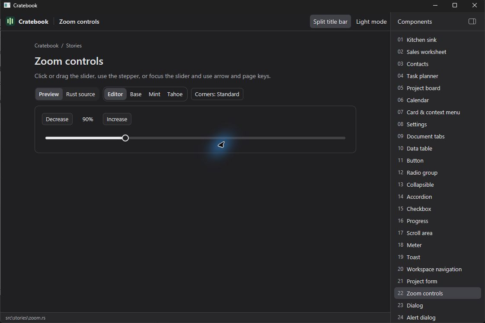
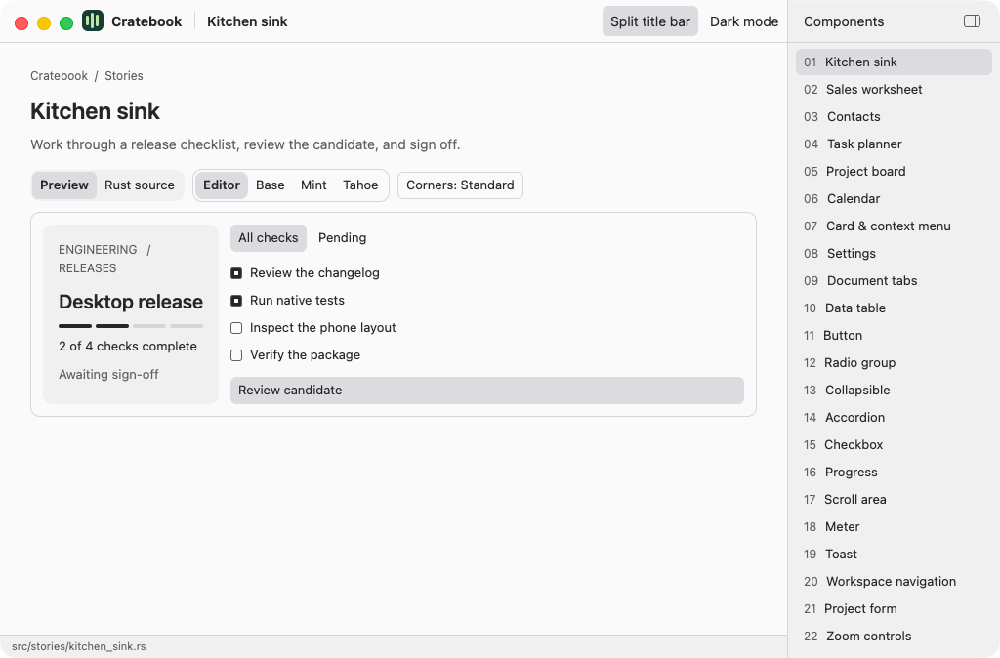

# Windows and macOS support review

Tested application revision: `025505377278df32beb36010bb7dd772d87853bf`.
Cratebook 0.1.7 uses GPUI Jig 0.1.9. The GPUI Jig Windows checkout was also
updated to `aaa7ec7` and passed 8 unit tests and 13 documentation tests.

## Improvements shipped

| Issue | Change |
| --- | --- |
| Zoom looked like a progress bar and accepted keyboard input only | Added a visible thumb, track clicking, drag input, endpoint clamping and 10-point steps. The stepper and accessible slider value share the same state. |
| A fast drag could finish before listeners were registered | Register window-wide move/release handlers during paint, before input starts. Dragging continues outside the track and ends on release. |
| macOS CI supplied a bare executable | Added an architecture-labeled Finder `.app` ZIP, version metadata, license resources, checksum and ad-hoc signature verification. The existing executable archive is retained. |
| Local macOS installer had a hardcoded bundle version and built the capture helper too | Reuse the same bundle script, derive the version from Cargo.toml, build only the main binary and stop early on non-macOS hosts. |
| macOS had no application reopen callback | Register GPUI's `on_reopen`: create a gallery when no window remains, otherwise activate the existing application. |

## Evidence and limits

[The complete native CI run](https://github.com/kahwee/cratebook/actions/runs/41269235520)
passed Windows tests, macOS tests, portable Windows packaging, macOS app packaging,
WebAssembly packaging and gallery publication. Both native test jobs passed all
five application tests. Local Windows formatting, tests and release compilation
also passed.

Windows Computer Use confirmed track clicking, fast thumb dragging to 50%, dragging
outside the track to the 200% limit, release followed by pointer movement without
further changes, Home, Page Up, Right, stepper synchronization and dark-mode drag.
For example, Home selected 50%, Page Up selected 150%, Right selected 160%, and
Decrease selected 150%. The Windows interaction build used `2279892`; the later
application change in `0255053` adds the macOS-only reopen callback.

The macOS packaging job launched the `.app` through `open`, observed a native
Cratebook window, and captured it. Its host reported macOS 26.6.2 (25G83) and an
ARM64 Mach-O executable. The ZIP checksum, executable permissions, version 0.1.7
and signature resources were inspected after download. CI verified the ad-hoc
signature. The screenshot below was inspected and shows the populated gallery.
Closing the final window and reopening from the Dock still needs an interactive
macOS check; the new callback is compiled and the initial bundle launch is tested.

The Windows ZIP passed checksum/integrity checks, x86-64 PE and GUI-subsystem
inspection, and inspection for static Visual C++ runtime linkage. These checks
do not replace testing on a clean Windows installation.

Screenshots are informational. No screenshot size checks or retakes were added.

Windows zoom after dragging in dark mode:

Finder-launched macOS app (initial gallery view):

## Recommended next fixes

| Priority | Finding | Suggested fix |
| --- | --- | --- |
| P1 | Demo text fields append `key_char` text and handle backspace/paste; full selection and native IME composition are not implemented | Replace per-story key handlers with a shared editor implementing GPUI `EntityInputHandler`, including selection, marked text and replacement ranges. Test native CJK composition and cursor movement on Windows and macOS. |
| P1 before a public installer release | Windows executables are unsigned; the new Mac app uses an ad-hoc signature, not a Developer ID/notarized distribution | Add credential-backed Authenticode and Developer ID/notarization release jobs. Test downloaded artifacts through the normal OS launch flow. The current CI launch exercises a locally built app. |
| P2 | The observed Mac package is ARM64; there is no Intel macOS build in this workflow | Add an Intel build/test job and separately labeled package, or build and test a universal binary. Keep architecture labels in download names. |
| P2 | Cargo reports a Windows `cratebook.pdb` output-name collision between the library and binary | Give the native/shared library a distinct crate/output name, preserve the `cratebook.exe` name, and update the WASM packaging paths together. The current build succeeds; this is a build-maintenance issue. |
| P2 | README-only pushes still trigger the heavy native build workflow and can cancel an active run | Add README.md to that workflow's documentation path exclusions, retain the quick feedback job, and use manual dispatch when documentation packaging needs explicit checking. |

The next interactive macOS pass should cover Dock reopen after closing all windows,
slider dragging/release, Command-key clipboard behavior and menu navigation.
