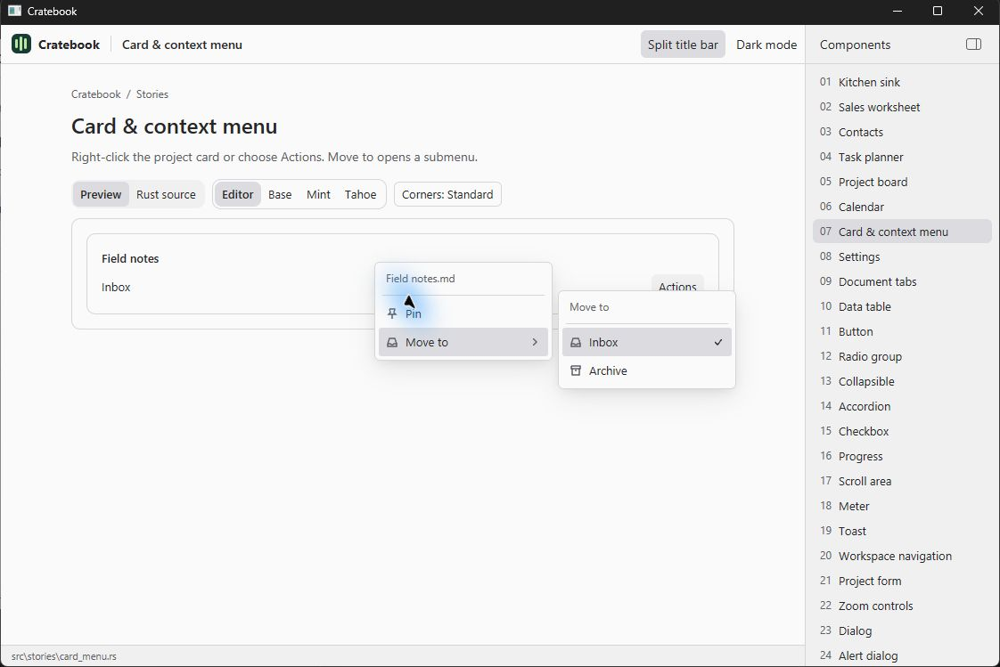
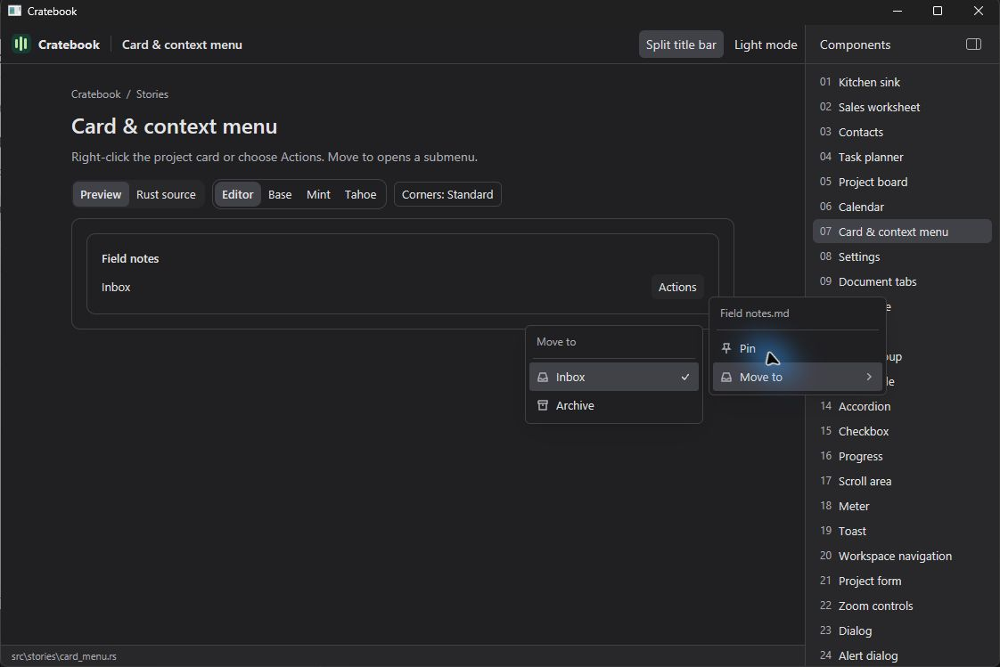
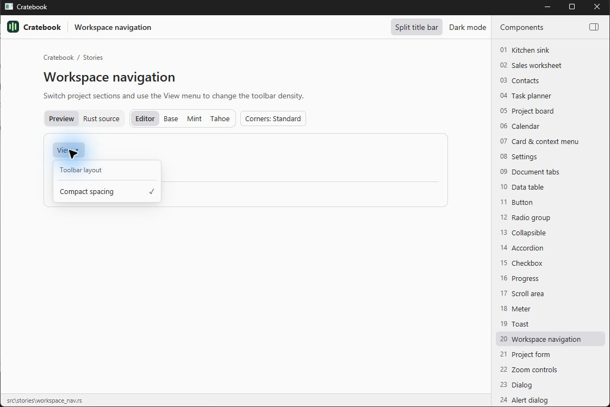

# Windows menus: native interaction review

Menu implementation: `cf53c8e969b43a058de3d65b3fe4a0dc3418228d`.
Reviewed in the normal native Windows MSVC release build, Editor, Standard corners,
light and dark appearance. These screenshots are informational.

Right-click menus now have wider rows, a quiet filename caption, a separator,
consistent icons, trailing submenu arrows and selection checkmarks. Hover opens
the secondary menu. Its panel opens on the available side without shifting the
parent menu; the layout keeps panels inside the app viewport. Compact layouts use
44-pixel menu rows. The workspace View menu is a floating dropdown anchored just
below a compact trigger, with matching border, corners and shadow.

## Native checks completed

| Interaction | Observed result |
| --- | --- |
| Right-click the project card | Menu opens at the pointer |
| Hover Move to | Secondary menu opens without clicking |
| Hover a sibling command | Secondary menu closes and highlight follows pointer |
| Choose Archive | Card folder updates; both menus close |
| Choose Pin | Card shows Pinned; reopening shows Unpin with a checkmark |
| Actions, Return and Shift+F10 | Menu opens at the Actions trigger |
| Down, Right, Left, Escape | Select a command, open submenu, return to parent, dismiss and restore focus |
| Open near the right side | Submenu opens to the left; parent stays in place |
| Click outside the context menu | Menu dismisses; focus returns to Actions |
| View trigger, including repeated click | Dropdown opens directly below trigger and closes on another click |
| View: Down then Return | Keyboard opens menu, toggles density, closes and restores trigger focus |
| View: reopen after toggling | Compact spacing checkmark reflects the current setting |
| View: Escape and outside click | Dropdown dismisses and restores trigger focus |
| Light and dark appearance | Menu surfaces, borders, icons and selected rows remain visible |

`cargo fmt --all --check`, native `cargo test --locked` (4 tests), and the native
release build passed. A regression test covers submenu placement near window
edges and stable parent position. This review does not establish complete screen
reader, IME or frame-time behavior.

## Informational screenshots

| Light: right-click and secondary menu | Dark: secondary menu opening left |
| --- | --- |
|  |  |

